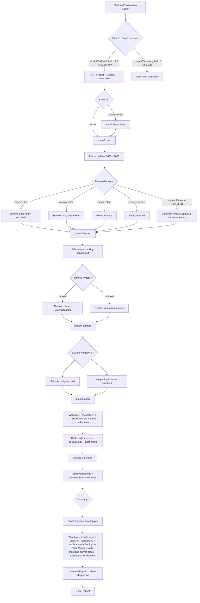

# EBOS [build 20261018.r11h2l]

Copyright (c) EBOS. Licensed under the PolyForm Noncommercial License 1.0.0 — see `LICENSE.txt`.

EBOS fully optimizes stock Windows for better responsiveness, max performance and zero tracking. This release is geared towards competitive gamers. Apply with AME Wizard in ~15 minutes.

## Requirements

- Stock Windows 10 (19041–19045) or Windows 11 (22000, 22621, 22631, 26100, 26200, 26220, 26300, 28000). The authoritative list is `SupportedBuilds` in `playbook.conf`; `preflight-check.ps1` uses the same list.
- No pending updates, no third-party antivirus, BitLocker off, plugged in, active internet connection (needed for the Windhawk transparency mods in phase 7 and for the optional Brave download); VC++ redist is bundled (no internet needed for it)
- Close games and anti-cheat processes (Fortnite, EasyAntiCheat, BattlEye) before applying. The Windhawk installer refuses to change the global transparency while they run, so phase 7 would stop before applying the mod settings.
- The AME wizard enforces `DefenderToggled`: it asks you to switch off the four Windows Security toggles and will not continue until they are off. EBOS only removes Defender when its service is already disabled; on a normal system Defender stays installed, so the toggles can be switched back on after apply.

## Package layout

```
EBOS-11H2-release-r11/
├── playbook.conf            # wizard UI, options, supported builds
├── playbook.png             # wizard banner
├── BUILD-INFO.txt           # build id + applied steps
├── LICENSE.txt              # Copyright (c) EBOS + PolyForm terms
├── README.md                # this file
├── Configuration/
│   ├── main.yml             # Admin: phase1 → phase7
│   └── Tasks/
│       ├── phase1-prepare.yml
│       ├── phase2-strip.yml
│       ├── phase3-harden.yml
│       ├── phase4-gaming.yml
│       ├── phase5-apply.yml
│       ├── phase6-extended.yml
│       └── phase7-privacy.yml
├── Executables/             # scripts, theme, icons, images, dxredist, cursors/
│   ├── ebos-dark.theme      # EBOS Dark (Akzent #007AFF / Hintergrund #06101E)
│   ├── ebos-verify.ps1      # post-apply check → %WINDIR%\EBOS\ebos-skipped.txt
│   ├── Install-WindhawkTransparentUI.ps1  # phase7: windhawk-cli + blurred-glass taskbar/Explorer/Start menu/notifications/Settings/Task Manager + all-process window transparency
│   ├── defender-state.ps1   # phase1: Defender status snapshot → %WINDIR%\EBOS\defender-state.txt
│   ├── defender-status.ps1  # phase7: read-only Defender check → %WINDIR%\EBOS\defender-status.txt
│   ├── windhawk-cli-1.1.0-installer.exe   # SHA-256 63962b29…7a238ab (hansonxyz/windhawk-cli v1.1.0)
│   ├── restore-personalization.ps1  # logon guard (cursors + wallpaper + dark palette)
│   ├── cursors/             # 17x ebos-*.ani
│   ├── dxredist/            # DirectX runtime (DXSETUP.exe /silent)
│   ├── wallpaper.png / lockscreen.png / profile.png
│   └── ebos.ico / discord.ico (real ICO)
└── Images/
    └── brave.png            # browser option icon
```

## Install flowchart



## Wizard options (playbook.conf)

| Option | Effect |
|---|---|
| `browser-brave` | Install Brave silently |
| `remove-bloat` | Remove bloatware AppX + provisioned |
| `remove-xbox` | Remove Xbox + GameBar |
| `remove-store` | Remove Microsoft Store |
| `remove-edge` | Remove Edge |
| `remove-ai` | Remove Copilot/Recall |
| `remove-onedrive` | Strip OneDrive + scheduled tasks |
| `remove-hyperv` | Remove Hyper-V/Virtualization (breaks WSL/VMs/emulators) |
| `disable-mitigations` | VBS/HVCI off, vulnerable-driver blocklist off |
| `disable-power-saving` | Ultimate Performance plan, hibernate off |
| `disable-auto-driver-updates` | Exclude drivers from Windows Update |
| `disable-printing` | Printing stack off |
| `disable-webview2` | Remove WebView2 |
| `disable-wifi` | Wi-Fi stack off |
| `disable-bluetooth` | Bluetooth stack off |
| `disable-location` | Location + Maps off |
| `disable-storage-sense` | Storage Sense off |
| `fs-privacy` | Extra privacy hardening (phase7) |

## Always applied (no wizard option)

These are written unconditionally by the phases; they are no longer options in `playbook.conf`.

| Feature | Effect |
|---|---|
| Wallpaper + lockscreen + cursors | EBOS wallpaper, lockscreen and 17 cursors |
| Dark mode + theme | System/app dark mode and the applied `EBOS-dark.theme` (complete high-contrast classic palette: Window `10 24 42`, white text, EBOS-blue highlight) |
| Animations | Animation effects off |
| Transparency | Transparency effects on + blurred glass on the taskbar, Start menu, notification center, File Explorer, Settings, Task Manager and classic Win32 windows, including third-party programs. The taskbar and notification center reuse the Start menu's `BlurAmount=25` glass brush (`TintColor="#25323232"`) instead of pure transparency; Task Manager uses the same `#25323232` tint and keeps its blur when unfocused. Packaged Store/UWP app content keeps its native Mica/Acrylic; Windows shell surfaces hosted by packaged processes (notification center) are styled |
| Context menu | Windows 10 context menu |
| Taskbar | Icons only, no labels or app names (`TaskbarGlomLevel=0` / `MMTaskbarGlomLevel=0` for the current user and `.DEFAULT`), small taskbar where `TaskbarSize` is supported (`TaskbarSize=1`) |
| Task Manager | The normal Ctrl+Shift+Esc Task Manager inherits the acrylic shell from the native `Taskmgr.exe` process rule and, through the local `taskmgr-ebos-palette` Windhawk mod, the EBOS navy palette in its classic process list (`COLOR_WINDOW` and `COLOR_BTNFACE` are deep navy, not black). Blur tint matches the shell glass (`25323232`) and remains active when the window is unfocused. No separate shortcut, helper, INI or scheduled task is used |
| Desktop icons | Small icons |
| Clipboard history | Kept enabled (`AllowClipboardHistory=1`); cloud clipboard sync stays off |

## Verification

After apply, `ebos-verify.ps1` re-reads every declared registry value, key, service, task, AppX entry and file (theme content, 17 cursors, ICO headers). Anything that did not take is logged to `%WINDIR%\EBOS\ebos-skipped.txt`. Gated options that were unticked count as not-applicable, not failures.

## Notes

- Defender removal is destructive and needs the reboot notice; re-enable only via stock reinstall path. Every removal stage is gated on phase 1's recorded state: when Defender is ACTIVE it stays installed and fully functional, and `defender-status.ps1` reports that explicitly. `nuke-defender-files.ps1` also has a fail-safe: it writes the `DefenderToggled` disable values and the `EBOSDefenderKeepDisabled` task only after `WinDefend` is actually unregistered and `MsMpEng` is no longer running. If a removal pass fails, any stale disable persistence is removed and real-time, behavior and IOAV protection are switched back on, so a live Defender cannot be left half-disabled.
- `disable-mitigations` + most anticheats don't mix — leave mitigations on for competitive games.
- Personalization guard runs at each logon and repairs only what Windows reset (26H2 regression).
- **Task Manager is native:** `Ctrl+Shift+Esc` and the normal Task Manager shortcut use the `Taskmgr.exe` process rule; there is no separate Task-Manager (Acryl) shortcut, VBS launcher, helper or scheduled task. The installer removes those legacy artifacts and the abandoned `taskmgr-ebos-glass-dev` development mod on every run, so the Task Manager look does not depend on a launcher or INI.
- **Transparency scope:** the global `translucent-windows` mod uses `Include=*`, so every process - including third-party Win32 programs - receives the shared `#25323232` acrylic glass. Apps that paint their own opaque client area (Chromium/Electron, games) can still look opaque even though the mod is loaded; the effect is visible where the app uses the standard window background. Taskbar, Start menu, notifications, Settings, Explorer and Task Manager are styled by their own mods; classic Windows tools (Character Map, Registry Editor, MMC, ...) get the shared `#25323232` glass from the global mod. The taskbar uses the built-in `TranslucentTaskbar` theme, and both the taskbar and notification center override their theme's `$CommonBgBrush` with the Start menu's `BlurAmount=25` glass (`TintColor="#25323232"`), so all shell surfaces blur consistently. Settings keeps the built-in acrylic window background of `Translucent_Settings11`. Games with their own fullscreen rendering and anti-cheat clients remain a caveat: the Fortnite rule opts that client out, and the installer refuses to apply while a known anti-cheat process is running. The mod does not target UWP/WinUI content, so packaged Store/UWP apps (Calculator, Photos, ...) keep their native Mica/Acrylic even when the engine is loaded. Apps already running when the scope changed keep the injected DLL until restarted; new processes follow the include list immediately.
- **Explorer styling:** the File Explorer Styler runs the built-in `Translucent Explorer11` theme with the `acrylic` backdrop, so the window stays wallpaper-tinted (navy over the EBOS wallpaper, lighter over bright windows). The installer overrides the dark-theme text resources `AppBarButtonForeground`, `CommandBarForeground` and `TextFillColorPrimary/Secondary/TertiaryBrush` to white/near-white and adds three `controlStyles` for `AppBarButton`, `TextLabel` and `FontIcon`. File names, the address breadcrumb, command bar labels/icons, the sidebar and the details pane therefore keep high contrast on the glass. The quoted XAML values are written as raw `REG_SZ` values because `whcli set-setting` would strip the quotes; verification reads them back raw.
- **Packaged Windows apps (AppContainer):** the Windhawk engine can only keep its mods loaded in an AppContainer process when `ALL APPLICATION PACKAGES` (`S-1-15-2-1`) can read the engine's data folder (`AppDataPath`, normally `C:\ProgramData\WindhawkCLI\Engine`). Program Files already grants this; ProgramData does not. The installer grants the read ACE recursively (`icacls ... /grant *S-1-15-2-1:(OI)(CI)(RX) /T`) and verifies it, so `ShellExperienceHost.exe` keeps the notification-center styler and the global mod. The notification center uses the same glass as the Start menu: the theme's `$CommonBgBrush` is overridden through `styleConstants[0]` with `TintColor="#25323232"` and `BlurAmount="25"` instead of its built-in ~15%/BlurAmount=18 value. UWP/WinUI app content remains opaque; the glass applies to the Windows shell surface hosted in the packaged process.
- **Task Manager styling:** the installer adds the process rule `RuledPrograms -> Taskmgr.exe` with `RenderingMod.ThemeBackground=1`, `BackgroundEffects.type=acrylicblur` and `AccentBlurBehind=25323232` (the same tint as the `#25323232` shell glass). The normal XAML window therefore keeps a blurred, tinted shell even when it is not focused. Its custom rendering also installs `GetSysColor`/`GetSysColorBrush` hooks that hard-code `COLOR_WINDOW` and `COLOR_BTNFACE` to black, which turns the modern task list (a classic `SysListView32`) solid black. A local companion mod, `taskmgr-ebos-palette`, is installed from `Executables/WindhawkMods` with the include `taskmgr.exe`. It installs its own color hooks from `Wh_ModAfterInit` (after the global mod has registered its hooks) and returns the EBOS palette from `ebos-dark.theme`: `Window=10 24 42`, white `WindowText`, EBOS-blue highlight, light-gray `GrayText`. The result is a blurred glass shell with a deep-navy, high-contrast process list and search bar. The process still ends up High Integrity, and `whcli mod-status` only lists it when run elevated. Task Manager is single-instance; use the normal shortcut or `Ctrl+Shift+Esc`. The installer and uninstaller remove the old shortcut, VBS launcher, helper, scheduled task and dev-mod INI; no auxiliary launcher remains.
